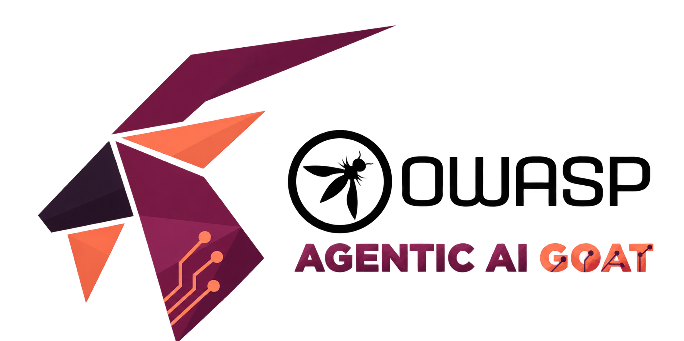

<p align="center">
  
</p>

<h1 align="center">OWASP Agentic AI GOAT</h1>

<p align="center">Practice attacking and defending AI agents.</p>

<p align="center">
  <a href="https://owasp.org/projects/agentic-ai-goat"></a>
  <a href="https://github.com/OWASP/OWASP-Agentic-AI-Goat/actions/workflows/contribution-checks.yml"></a>
  <a href="LICENSE"></a>
</p>

<p align="center">
  <a href="https://github.com/OWASP/OWASP-Agentic-AI-Goat/stargazers"></a>
  <a href="https://github.com/OWASP/OWASP-Agentic-AI-Goat/issues"></a>
  <a href="docs/CONTRIBUTING.md"></a>
  <a href="CODE_OF_CONDUCT.md"></a>
</p>

<p align="center">
  <a href="#installation">Install</a> ·
  <a href="#start-and-use">Use</a> ·
  <a href="#configuration">Configure</a> ·
  <a href="#guides">Documentation</a> ·
  <a href="#contributing">Contribute</a> ·
  <a href="#donations">Donate</a>
</p>

OWASP Agentic AI GOAT is a deliberately vulnerable application for learning how to attack and defend AI agents. It includes prompt injection, RAG and email attacks, SQL and NoSQL injection, XSS, MCP labs, a prompt-injection CTF, and SecureShop, an AI-powered shopping application.

Run it locally for training. Never expose it to the internet or use real sensitive data in the labs.

## Installation

Clone the repository:

```bash
git clone https://github.com/OWASP/OWASP-Agentic-AI-Goat.git
cd OWASP-Agentic-AI-Goat
```

Run the installer for your operating system:

```bash
# macOS
bash scripts/install/Mac/install-macos.sh

# Ubuntu / Debian Linux
bash scripts/install/Linux/install-linux.sh
```

For Windows, follow the [Windows installation guide](docs/install/INSTALLATION.md#native-windows).

Setup installs dependencies, prepares PostgreSQL and local lab services, downloads the local AI model, and creates your private `.env`. Local Ollama does not need an API key. The first installation downloads several gigabytes; model speed depends on your hardware.

Read the [installation guide](docs/install/INSTALLATION.md) for requirements, upgrades, repair, and troubleshooting. If the prerequisites are already installed and Ollama is running, you can use `npm run setup` directly.

## Start and use

On macOS or Linux:

```bash
./start_all.sh
```

Open [localhost:3000](http://localhost:3000) and sign in with the [initial accounts](docs/install/INSTALLATION.md#initial-accounts). Existing installations keep their current credentials.

- Choose an exercise from the workshop dashboard and follow its objectives. Hints and solutions are available when enabled by the instructor.
- Open the [admin panel](http://localhost:3000/admin) to manage students, exercises, hints, solutions, and progress.
- Try the [prompt-injection CTF](http://localhost:3000/ctf) or [SecureShop](http://localhost:3000/secureshop). SecureShop uses separate practice accounts.

Stop with Ctrl+C in the launcher terminal or run `./stop_all.sh`. Use the exercise reset controls to reset progress.

See the [quick start](docs/QUICK_START.md) for Windows startup, service checks, and more usage details.

## Configuration

Keep credentials in your private `.env`. Do not commit them.

- [Environment settings](.env.example): AI providers, models, grading, ports, and lab settings. Ollama is the default; cloud providers require your own credentials.
- [Tracing at smith.langchain.com](docs/install/LANGSMITH.md): configure tracing and inspect LangGraph decisions, LangChain model calls, and tool results.
- [Email setup](docs/install/SMTP_SETUP.md): Gmail SMTP, SharkLasers, and local Mailpit delivery. Choose the workshop email provider in Admin → Settings → Email Delivery. With Mailpit selected, the IPI and XSS email labs include a link to the inbox.
- [Workshop entry password](docs/install/INSTALLATION.md#optional-workshop-entry-password): restrict entry during an event.
- [Custom ports and browser origins](docs/install/INSTALLATION.md#browser-origins-and-custom-ports) and [reverse proxies](docs/install/INSTALLATION.md#reverse-proxies).
- [SecureShop setup](docs/secureshop/README.md): shop accounts, agents, and optional services.

## Guides

- [Workshop guides](docs/workshops/README.md) and [facilitator outline](docs/workshops/WORKSHOP_OUTLINE.md)
- [All documentation](docs/README.md)
- [Architecture](docs/ARCHITECTURE.md)
- [Current release status and known limitations](docs/modernization/current-release-status.md)
- [Installation recovery](docs/install/local-recovery-contract.md)
- [Security policy](docs/SECURITY.md)

Some exercises and model-based grading paths are still being verified. Check the release status before planning a workshop around them.

## Contributing

Bug fixes, new lessons, and documentation improvements are welcome. Read the [contribution guide](docs/CONTRIBUTING.md) for development and testing instructions, or [open an issue](https://github.com/OWASP/OWASP-Agentic-AI-Goat/issues) to report a bug or suggest a change. Preserve the intentional vulnerabilities used by the exercises.

Report security problems through the [security policy](docs/SECURITY.md).

## Donations

You can [donate to OWASP Juice Shop through the OWASP Foundation](https://owasp.org/donate?reponame=www-project-juice-shop&title=OWASP%20Juice%20Shop). This donation link supports Juice Shop, not Agentic AI GOAT.

## License and credits

[GNU General Public License v3.0](LICENSE).

Created by [Abhinav Verma](https://www.linkedin.com/in/secureabhinavverma/) with love for the security community.
