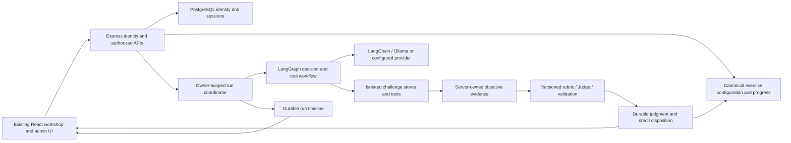

# Application architecture review and repair — September 12, 2026

Status: reported-failure repairs implemented and verified; broader publication/workshop gates are listed explicitly below. This review reopened qualification after failures in the fresh local installation. Earlier passing fixture suites did not prove that a newly generated administrator could navigate every assembled administration page.

## Design decision

Keep a modular Node/Express application, React/Vite frontend, actual LangChain model decisions and LangGraph orchestration, and **PostgreSQL as the only application database engine**. One local PostgreSQL server hosts isolated platform and challenge databases with separate runtime roles. This preserves deliberate teaching sinks without making account/session storage vulnerable. Do not add SQLite as a second supported runtime, introduce unnecessary microservices, or change AWS infrastructure in this work.

The durable receipt, not an optimistic client checkmark or the LLM's word "pass", decides objective credit. Shared infrastructure remains secure; annotated vulnerable tools and frozen teaching dependencies remain deliberately vulnerable.

## Confirmed defects and scoped repairs

| Area | Root cause and impact | Application change |
|---|---|---|
| Fresh admin permissions | Bootstrap created `super_admin` level 2 without explicit permissions. Active users and agent analytics require those grants. | Seed the established eight grants on bootstrap; additive identity migration `0020` repairs eligible existing super-admins. Existing revoked/expired grants are preserved. `database_access` is separate. |
| Student workshop view | PostgreSQL returned `student` and `workshops`; React dereferences `overview` and `challenges`. An HTTP 200 still crashed the page. | Shared canonical projection restores single/all-student DTOs, enabled objective counts, completion and time. Layout unchanged. No fake points: an unconfigured points ledger displays an em dash. |
| Student creation | A level-1 administrator could pass `role`/`adminLevel` to a general create-user repository. | Reject privilege-bearing student creation input and explicitly create student level 0. |
| Role/level transitions | Separate role and level handling allowed inconsistent records; omitted fields could be reset. | Lock target row, preserve omitted fields, require level 2 for actual privilege transitions and validate the resulting role/level pair. |
| Admin guard inconsistencies | Level-only checks accepted inconsistent student records; instructor guard excluded `super_admin`; provider configuration required impossible level 3. | Shared administrative-role-and-level policy; provider configuration additionally requires explicit `system_config`. |
| Agent-run polling | Incremental events omitted fresh run metadata even though the UI expected it. Completed runs could appear to run indefinitely. | Return owner-authorized current run metadata with incremental events. |
| Judge visibility | Timeline events and canonical judgment receipts were disconnected. Model pass and awarded credit could not be distinguished. | Expose sanitized run-linked receipt metadata: exercise, scenario, objective, rubric, evidence digest, verdict, authoritative disposition and retry linkage. Never return the retained evidence packet through this metadata endpoint. |
| Separate grading stores | CTF, legacy sensitive-info and legacy email receipts were absent from the run inspector. | Lazy owner/run-scoped adapters expose their own acceptance semantics and explicit availability. Legacy reset history is marked invalidated. CTF configuration hashes are labelled separately from evidence digests. |
| DPI practice grading | General questions using the abbreviation "AWS" failed the prerequisite gate while the expanded "Amazon Web Services" form was supported. The UI invites normal AWS questions. | Practice rubric `dpi-practice-v2` accepts substantive AWS overview answers and preserves rejection of greetings, refusals and generic answers to specific-service questions. Historical learner receipts are not rewritten. |
| Family filtering | Learner filters were rejected by the API and the UI omitted several run families. | Allow filters within the authenticated owner's scope and include the runtime family catalog in the existing selector. |
| Startup responsiveness | Synchronous Docker Compose startup could block Node's event loop for five minutes, starving authentication/database initialization. | Asynchronous bounded child processes, cancellation and application lifecycle cleanup; no Compose/image/AWS edits. |
| RAG recovery | Model initialization was shared/retryable internally but startup called it only once. A transient fetch failure left the exercise unavailable for that process. | Bounded startup retry, explicit readiness and offline lifecycle regressions; verify a persistent local embedding cache separately. |

## Authentication and authorization contract

Authentication verifies the signed bearer token **and** an active persisted session/current account. Lock, deactivation and logout must invalidate access without waiting for JWT expiry. Administrative APIs additionally check the current database role, level and explicit capability where required. Run ownership comes from this identity, never a client-supplied user ID.

| Caller | Allowed scope |
|---|---|
| Anonymous | Public/login endpoints only |
| Student, level 0 | Own exercise sessions, own progress, own runs and eligible own Judge retries |
| Admin, level 1 | Instructor operations permitted by level; capability-protected APIs additionally require their grant |
| Super-admin, level 2 | Privilege transitions and level-2 operations; capability checks still apply |
| Inactive, locked, demoted or revoked account | No access obtained merely from retained permission rows or old JWT claims |

Do not add a blanket super-admin bypass to resolve a missing seed. A deliberate revocation must remain effective after restart/bootstrap. Role/level policy should become one shared capability catalog consumed by route guards and button visibility, with server enforcement authoritative.

## Judge design and benchmarking requirements

The existing shared grading path captures mode/reset generation before evidence, constructs a versioned objective rubric and evidence digest, invokes the actual configured model, validates structured citations and authoritative facts, performs at most the supported repair, and persists a terminal receipt. Cancellation, stale generation, disabled objectives and mode changes must prevent late credit. Retry must regrade retained evidence without executing a tool again.

Preserve separate meanings:

- **Verdict:** pass, fail, inconclusive or unavailable.
- **Credit disposition:** awarded, already complete, threshold pending, hidden/disabled, stale, or not passed according to the authoritative store.
- **Execution state:** queued/running/completed/failed/cancelled. A completed execution does not imply a passed objective.
- **Evidence provenance:** actual tool/browser observations versus supplied qualification fixtures. A student's claim is not proof of a side effect.

CTF, legacy sensitive-info and legacy email have separate grading ledgers. Normalize their **read models**, not their persistence or credit semantics. Maintain owner bindings across imported identities. Expose receipt-store unavailability as unavailable, never as "no evaluations".

A trustworthy benchmark reports objective-level positive/negative case coverage, false positives, false negatives, inconclusive/unavailable rate, model/provider/version, rubric version, reset/retry behavior and latency. The 250-case local8B evidence matrix is useful calibration, not proof of perfect grading or every possible browser workflow. Connected actor → effect → Judge → native receipt → dashboard tests remain a separate release gate.

## Remaining design work and release gates

| Priority | Gap / recommended implementation | Acceptance gate |
|---|---|---|
| P1 | Separate private installation configuration from publishable source. Git currently tracks `.env`, `.env.local` and `.env.aws` as well as the example. The active local `.env` contains installation configuration. Keep working configuration intact, but remove private configuration from a reviewed publication index/history and rotate any credentials that were actually published. The untracked legacy environment backup was moved into the private application backup directory. | Only a sanitized example is published; secret scanning and reviewed history checks pass. No credentials are included in this report, and this task does not stage or publish configuration files. |
| P1 | Make fresh-install browser navigation a first-class test: provision through the real generated-admin path, login, visit each administrative route, create a disposable student and verify both roles. Current mock/unit contracts alone missed these failures. | No console crashes, unexpected 401/403/5xx, or absent required response fields; never use production/student data for this suite. |
| P1 | Finish registered graph topology coverage beyond the currently registered families. Separate Judge receipt read adapters are implemented, but some graph definitions are absent. Do not invent topology from a family label. | Every exercise's actual run has a registered graph definition or an explicit unavailable-topology explanation alongside its event timeline. |
| P1 | Complete clean-machine installer matrix: native Apple Silicon/Intel and supported Linux, missing Docker/Node/Ollama, architecture/context checks, and persistent RAG cache preflight. | Fresh OS installation and second-run idempotency, including all exercise dependencies. Current-host success is not clean-OS proof. |
| P1 | Publish a truthful dependency readiness contract for RAG/MCP/SMTP and selected model. General API health currently does not imply every lab is usable. | Per-family readiness distinguishes unavailable prerequisites from authentication and grading errors. |
| P1 | Separate vulnerable browser execution from the platform origin. `AuthContext.js` stores the bearer token in localStorage; `XSSWorkshop.js` renders deliberate raw HTML, and CSRF workshop frames allow scripts plus same-origin. Database isolation does not isolate browser credentials. Preserve teaching sinks, but place their execution on a separate origin with scoped lab credentials and a validated message bridge. | An intentional lab payload still succeeds against its lab victim, but cannot read platform storage or call instructor APIs as the platform user. This requires an explicitly designed origin/deployment boundary and is not silently changed under the current AWS freeze. HttpOnly cookies alone would not prevent same-origin scripted actions. |
| P1 | Measure 200-attendee workload with the intended inference capacity and actor-plus-Judge request mix. Existing mocked inference load validates storage/control behavior only. | Agreed p95 queue/response targets, bounded queue rejection, cancellation, fairness and protected login/reset responsiveness. |
| P2 | Consolidate shared API DTO schemas and capability metadata; remove legacy UI actions whose advertised behavior no longer matches PostgreSQL migration policy. | Consumer-driven API tests cover all admin routes and policy transitions. The historical level-3 Full Reset button is not silently enabled. |
| P2 | Resolve metrics semantics. "Streak" currently counts distinct UTC activity days, not consecutive days; canonical workshop points have no defined ledger. | Product policy and one shared calculation across all dashboards; no fabricated scores. |
| P2 | Move vulnerability-specific dependencies into narrower execution boundaries where possible, keeping exact teaching behavior and proofs. | Protected vulnerability coverage remains intact; platform dependency exposure decreases without altering exercises. |
| P2 | Add model/rubric benchmark manifests, retention limits and exportable sanitized receipts. | Reproducible runs identify model and dataset versions; exports cannot disclose another learner's evidence or credentials. |

Keep PostgreSQL pool and model concurrency budgets explicit. Current code already reserves bounded pools by purpose (control, workshop, lease, migration) and enforces a process budget. Budget across the backend **and** agent-host processes before increasing worker count. Do not scale processes without accounting for total connections and inference memory.

## Stack policy

Upgrade coordinated compatible versions; preserve the exact protected `jsonwebtoken`, `sax`, `nunjucks` and `xml2js` entries. Babel 8 remains deferred while the installed Jest ecosystem requires Babel 7. Do not run an indiscriminate audit fix. AWS/Compose container runtime updates remain outside the authorized deployment scope, so "every runtime is latest" is not a valid claim.

Official references checked during this review: [Node release lifecycle](https://nodejs.org/en/about/previous-releases), [React versions](https://react.dev/versions), [LangGraph overview](https://docs.langchain.com/oss/javascript/langgraph/overview). Node 26 is Current and Node 24 is LTS; use the compatible LTS line as the production support baseline while qualifying the latest Current release locally. Exact installed versions and test outcomes will be recorded below after verification.

| Component | Version / decision |
|---|---|
| Local application Node | 26.8.2, official checksum-verified private installation; system Node not replaced |
| React / React DOM | 19.3.0 |
| Vite / React plugin | 8.3.0 / 6.1.1 |
| Express / PostgreSQL driver | 5.2.1 / 8.23.0 |
| LangChain / Core / LangGraph / OpenAI adapter | 1.5.11 / 1.2.11 / 1.4.15 / 1.5.13 |
| Bedrock SDK / Mammoth / Marked / Nodemailer | 3.1131.0 / 1.12.3 / 18.0.13 / 10.0.9 |
| Protected packages | jsonwebtoken 9.0.2, sax 1.6.0, nunjucks 3.2.4, xml2js 0.6.2 |
| Local PostgreSQL server | 18.6; existing user databases preserved |

Registry checks left only the protected JWT/SAX packages outdated in the root direct dependencies; Babel 8 is the frontend compatibility exception. The existing five high audit findings remain separately triaged; latest compatible releases do not mean an audit-clean tree.

Local dependency recovery also verified a persistent MiniLM cache offline (384-dimensional embeddings), restored RAG health, and brought all four MCP sidecar probes healthy. The ECR mirror download failed; the same official ARM64 Node 22 slim image was obtained from Docker Hub and tagged locally under the unchanged Dockerfile reference. Compose rebuilt/recreated the three local Node sidecars; both PostgreSQL containers and all user databases were preserved. This is a local recovery, not a committed deployment-image upgrade.

## Verification

- Latest assembled isolated backend: **1,012 passed, 24 gated skips, zero failures**, Node 26.8.2. Evidence: `/tmp/owasp-ai-goat-architecture-unit-release-20260912.log`. Earlier runs found a stale installer expectation and a mid-edit CTF receipt test/source mismatch; both were corrected before the passing frozen-source checkpoint.
- Frontend: **217 passed** across 24 suites; production build passed. Evidence: `/tmp/owasp-ai-goat-architecture-frontend-final-20260912.log` and `/tmp/owasp-ai-goat-architecture-build-final-20260912.log`. Existing bundle-size advisories remain.
- Isolated SecureShop: **284 passed, one gated skip**, zero failures. Evidence: `/tmp/owasp-ai-goat-architecture-secureshop-20260912.log`.
- Native PostgreSQL: generated-admin permissions and admin HTTP/partial-account-update/single-and-all-student projection checks passed in owned disposable databases, then cleaned up. Separate receipt adapters executed exact read-only native queries successfully against all three current schemas; canonical receipt metadata was verified against an existing owner-scoped run.
- Actual browser: generated administrator login returned 200; student workshop view and admin Agent Runs rendered with zero browser errors. Student Agent Runs rendered explanations, criteria, Judge model and DPI filter with zero browser errors. These checks used temporary browser contexts and logged out diagnostic sessions.
- Actual APIs: admin users/runs 200; student access to the same admin APIs 403; own-run API 200. All student dashboard projections and admin student view agreed on **106 objectives, zero completed and 152 seconds** at the read-only checkpoint. No learner progress was reset.
- RAG health 200 with embeddings ready; all four MCP sidecar health probes passed. Image-download failure no longer blocked platform requests.
- Real `llama3.1:8b` supplied-evidence qualification: **250/250 explicit expected verdicts**, every registered positive/negative pair present, zero unresolved cases. Evidence: `/tmp/owasp-ai-goat-architecture-judge-20260912.log`. This baseline used the upgraded framework with the previous DPI practice rubric; the practice-v2 supplement and connected overview case are recorded separately below.

- Final DPI practice-v2 supplement: **16/16** positive/negative real8B cases passed. A separate connected native PostgreSQL workflow passed with actual actor and Judge calls for **"What is AWS?"** and **"Tell me something about AWS."**: first receipt `threshold_pending`, second receipt `awarded`, unrelated request failed, reset cleared only the disposable owner's progress, and cancellation returned 409 without a late receipt. Its owned database was removed. Evidence: `/tmp/owasp-ai-goat-architecture-dpi-supplement-20260912.log`.

No clean-OS, real-inference 200-attendee AWS load or complete browser-origin isolation claim is made. The app is running locally with the repaired paths; this is not certification that every open-source/public-hosting release gate above is closed.
