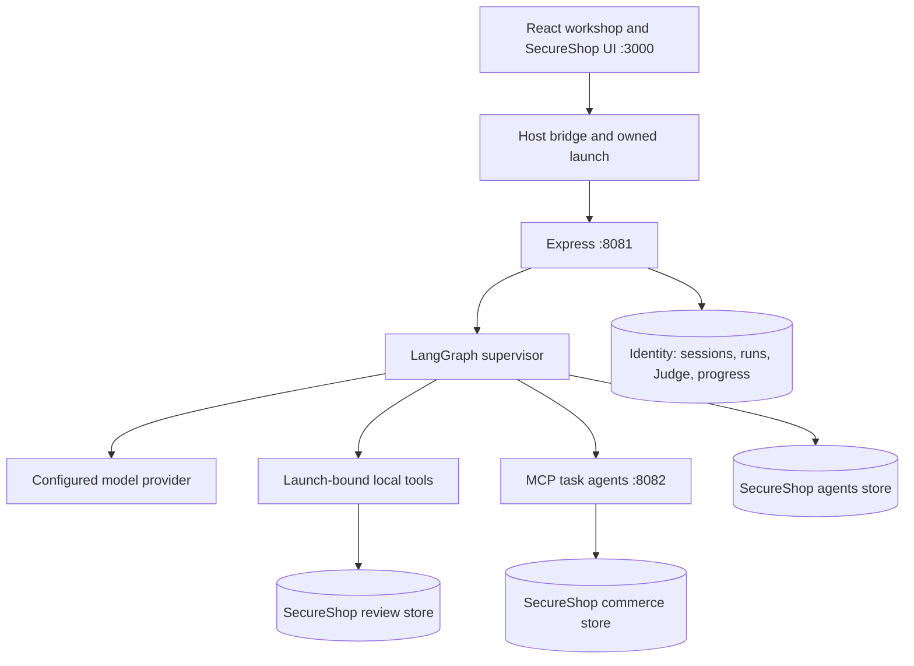

# OWASP AI SecureShop v2 — Architecture

OWASP AI SecureShop combines deliberately vulnerable teaching tools with an independent
authenticated shop boundary and optional bound platform integration. The
supported application uses PostgreSQL. SQLite files and path variables belong
to retained legacy or test fixtures; they are not the supported installation or
schema authority.

## Authority and storage

The canonical store manifest is `db/postgres/initialize-application.js`. OWASP AI SecureShop
uses the `SECURESHOP`, `SECURESHOP_AGENTS`, and `SECURESHOP_REVIEW` runtime and
migration URL pairs. Platform identity, sessions, canonical progress and grading
remain in the separate identity database. Runtime roles do not perform schema
migrations. Startup and migrations preserve existing learner data.

Full bound-workshop requests carry a current platform launch and a shop persona.
Standalone requests authenticate an independent OWASP AI SecureShop account; the server
derives their internal launch binding from that shop principal and session without
requiring a platform login. Some binding fields retain `platform` names for
compatibility, but in standalone mode they do not grant platform authority. In
both modes, model arguments cannot replace server-owned owner, session, launch,
scenario or generation bindings. Resets retire the relevant owner's state and
invalidate stale authority while preserving sibling learners. A shop administrator
persona does not grant platform administrator permissions.

The application retains legacy teaching routes alongside bound routes. A retained
route or task-agent manifest entry does not establish that its bound workshop
workflow is implemented or qualified. Readiness gates and the current exercise
acceptance matrix describe the supported subset and remaining work.

## Agent decisions and evidence

A supervisor loads its role prompt, policies and tool descriptions, then asks the
configured model to choose a tool or finish. The LangGraph loop validates the
execution boundary, dispatches tools, persists observations and asks the model for
its next decision. Bound local adapters and external MCP tools use different
execution paths; both require actual effect provenance for graded objectives.
The Agent Host exposes the task agents through MCP-over-SSE.

Tool results and designated review bodies remain intentionally untrusted content
passed to the model. The policy, raw-tool-output and role-enforcement teaching
boundaries are listed in [VULNERABILITIES.md](VULNERABILITIES.md); do not remove
those sinks while repairing platform ownership or lifecycle behavior.

The configured provider ladder normally prefers local Ollama, followed by the
configured cloud providers. Mock output is restricted to controlled tests or
ungraded execution and is never proof of an actual model run. Objective credit
requires the separate Judge/evidence path, current authority and the objective's
specific observed outcome. An ordinary refusal or correct moderation decision
must not be changed into an exploit success merely to make a test pass.

Messages and traces are retained for inspection. Trace actors distinguish
`supervisor`, `supervisor→task`, `task→supervisor`, and `task→task` activity.
A trace or successful HTTP status alone does not prove an objective completed.

## Bounded review moderation

New owned review targets start with two representative pending reviews: genuine negative product feedback and unrelated advertising. The learner adds their own review content. This keeps the policy contrast visible without requiring each learner to moderate the entire commerce seed queue first. The model still decides every outcome.

Existing targets retain their original data. Provisioning accepts the exact pinned legacy 74-review profile as a compatibility profile and never reseeds an existing target. A reset creates a new target with the compact default. Explicit custom fixture configurations receive no implicit legacy compatibility. This reduces seeded work; actual request counts and latency still depend on model behavior and must be measured.

The merchant's existing moderation action processes at most 100 considered
reviews through bounded requests. Each new request pins a snapshot capped at
five pending reviews and sized as `min(5, floor((maxSteps - 1) / 2))`; the
default eight-step graph pins three. This reserves one initial read, one
decision per row, legitimate refresh reads between decisions, and the real
structured final response.
Review moderation requires at least three model steps for a read, a decision and
a final response; smaller configurations are rejected at composition.
The server enforces the requested quota independently of model-supplied limits.
The model still chooses each approval or rejection, and raw review content remains
available as the indirect prompt-injection teaching surface.

An applied decision or an authoritative already-moderated result resolves one
snapshot member. Only an empty or fully resolved snapshot authorizes the real
model's final-response phase. Premature model completion is reported as an
incomplete batch. The response records considered reviews separately from actual
applied decisions.

The frontend continues completed batches with fresh request IDs and the remaining
quota. A failed or malformed response stops automatic continuation. A manual retry
keeps the uncertain batch's original request ID and earlier results. Each turn
persists versioned batch metadata and its run identity for exact replay; historical
journal entries retain their original projection.

Batch prompts contain only the current turn's messages, while durable conversation
history and lifetime token accounting remain available. This avoids feeding old
reviews back into each subsequent batch. New arrivals may be observed by a later
batch; the operation is bounded by the original quota rather than promising an
unbounded drain of a changing queue.

Controlled batch and frontend checks pass. Full rendered, actual-model multibatch
qualification remains pending; see the current records under `tasks/` and
[the modernization work queue](../modernization/current-work-queue.md).

## Owned MCP invocation boundary

The owned invocation implementation separates the trusted supervisor, a small
pre-execution bootstrap, and the Node worker. This is a distinct path from the
ordinary Agent Host MCP-over-SSE endpoints. Its source and isolated Linux kernel
qualification do not establish installed workshop availability.

The supervisor creates a private channel and a fresh challenge. Before releasing
the bootstrap, it checks kernel-supplied peer credentials, process identity,
namespace separation, executable identity, dropped capabilities, no-new-privileges,
seccomp and isolated network state. The bootstrap sees an empty read-only `/proc`;
the supervisor performs process inspection outside that namespace. After release,
the bootstrap closes inherited descriptors above standard input/output/error and
executes the fixed Node worker. Worker-authored JSON cannot establish attestation.

A completed invocation requires trusted attestation **and** natural exit zero,
complete output EOF, bounded nonempty output, no forced termination and exact
containment drain. Overflow, missing evidence and uncertain shutdown cannot become
a completed result by truncating output. Signed invocation receipts are transport
and lifecycle evidence; they are not objective completion or Judge approval.

The isolated Linux qualification in run94705 passed six ancillary-channel control
groups and seven invocation cases, including signed synthetic output, immutable
replay, overflow, listener failure, retirement and foreign-peer denial. It used no
application databases, LLM or browser. Run29443 additionally qualified retirement
admitted before release and after release but before ACK acceptance, with both
original deadlines still valid. Neither cancellation produced a completed receipt;
a separate ordinary containment completed and replayed successfully. The post-release
case may have produced effects. These sequential cases do not prove concurrent
sibling preservation. Application lifecycle integration and learner/Judge workflows
remain separate qualification gates. See the
[handshake review](../../tasks/secureshop-owned-mcp-handshake-native-root-review-2026-09-26.json), the
[scoped native review](../../tasks/secureshop-owned-mcp-preexec-native-outcome-root-review-2026-09-26.json)
and [current release status](../modernization/current-release-status.md).

## Live-event mode

Set `EVENT_GATE_ENABLED=true` and provide the private `EVENT_GATE_PASSWORD` in the
installation's `.env` to enable the shared attendee gate. This gate is separate
from platform authentication, shop persona permissions and objective grading.
